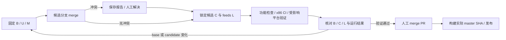

# 上游同步与候选构建

本文记录本 fork 的修复边界、已经实现的候选构建行为，以及基于
2026-10-14 仓库探索整理的 `Sync-Upstream` 替代方案。推荐保留 Git merge
历史，将同步改为“候选分支、功能检查、精确 SHA 构建、人工合入、默认分支
发布”。本文是实施设计，当前没有切换工作流或更改远端设置。

## 仓库探索结果

本次核对了两个工作流、profile、feeds 与构建 helper、fork 的有效树差异、
合并历史、远端权限和 Actions 日志。快照如下；数量只代表此次快照。

| 对象 | 检查结果 |
| --- | --- |
| fork 默认分支 `B` | `master`，`2abb33d9b48e615081b64b35ef2b4f78b68bd6f2` |
| 上游 `U` | `coolsnowwolf/lede:master`，`dcafc376a688efb0887b661b3a98a4c41a725984`；提交日期 2026-10-13 UTC |
| 共同祖先 `M` | `241650a12c1121c76ba6e82567f3cbd81e368d3d`，也是当前 fork HEAD 的第二父提交 |
| 历史分叉 | `B...U` 左侧 67、右侧 42 个提交；左侧包括历史导入，不能当成 67 个独立定制补丁 |
| 有效 fork 差异 `M → B` | 126 个文件，包括 package 52、target 55、scripts 8；不能只保护 workflows 与 profile |
| 当前正式构建 | `x86_64-passwall-docker`，x86 默认 kernel 6.18；没有 ARM 设备构建矩阵 |
| 最近正式构建 | [run 36071742062](https://github.com/mizuikki/lede/actions/runs/36071742062) 成功，源码是当前 `B` |
| 默认分支约束 | 没有 classic branch protection，仓库 rulesets 列表为空；merge、squash、rebase 均允许 |
| Actions 默认权限 | `write`；后续工作流需自行收紧。API 返回的 `can_approve_pull_request_reviews=false` 是机器人审批设置，不足以证明机器人创建 PR 的能力 |

现有 `.github/workflows/sync-upstream.yml` 先把上游合入并推送 `master`，再
dispatch 固件构建。因此即使合并没有文本冲突，编译或功能回归也只能在
默认分支已经变化后发现。

### 当前冲突的具体来源

对最新 `B/U` 执行 `git merge-tree --write-tree`，在不修改工作树的情况下
复现了唯一的文本冲突：`target/linux/qualcommax/image/ipq60xx.mk`。

上游 [e663ca9b4](https://github.com/coolsnowwolf/lede/commit/e663ca9b4cd74dbaa5cdd54bfa54baf876deb69f)
迁移 Qualcomm DTS 目录时，也调整了 `Device/EmmcImage`：factory padding
从 12288k 改为 6144k、删除 recovery 的生成规则，但 `IMAGES` 中仍声明
`recovery.bin`。fork 的历史导入
[2bddcb5fa](https://github.com/mizuikki/lede/commit/2bddcb5fae3e2e9b0994cde0fb42db816e808193)
已经改为仅声明 `factory.bin`、padding 6144k，两边因此在同一模板冲突。

候选处理应保留 upstream 的 DTS 迁移和其他新增兼容声明，按设备实际镜像
需求审查 EmmcImage，而不能整文件选 ours/theirs。还要检查 Philips、AnySafe、
ZN 等设备的 image、DTS、caldata 和升级路径。x86 CI 成功不能验证这些路径。
这里记录的是冲突处理依据，尚未解决冲突或验证设备镜像。

## 修复边界

本 fork 修复自己的配置、构建和发布逻辑。当前上游缺陷与历史同步导入的
上游缺陷继续跟踪，等待上游解决，不在本 fork 增加 driver 或升级框架补丁。

| 项目 | 当前处理 |
| --- | --- |
| Airoha reset 未初始化变量、YT921x RX 所有权、Nokia stock 环境 helper | 保留上游实现，跟踪上游修复 |
| 历史导入的 Airoha FIT 升级调用、Gemtek 默认 U-Boot 命令 | 保留现状，等待对应上游实现修复 |
| Gemtek PCIe x2 与新 API 的等价性、binding | 继续记录待验证；本轮没有加入寄存器 workaround |
| AN7583 默认 EIP93 选择 | 补齐 fork 配置需要的 `CONFIG_CRYPTO_HW`，不修改 driver |
| profile 中已经不存在的 `trojan-plus` 选择 | 删除失效的 fork 配置项，不恢复上游已删除的 package |
| 指定源码 SHA 的候选构建和发布归属 | 使用实际 checkout SHA；候选构建上传 Actions artifacts |

上游问题按审查过的 `8e6869b60` 和后续远端快照 `f820e495d` 登记：Airoha
reset／Nokia helper 来自 `351ec9813`，YT921x 来自 `14590b681`，历史导入项
来自 `18ce6f116`。后续跟踪上游修复提交，不在本 fork 维护这些修复的副本。

fork 修复验收和上游问题跟踪分开；已经明确延期的上游缺陷继续登记。完整
x86 CI 的结论仅适用于该 profile，受影响的 Airoha、Rockchip 硬件行为仍需在
上游修复后验证，不能写成“已通过实机验证”。

## 已实现的 OpenWrt-CI 行为

工作流仍由 `workflow_dispatch` 触发，`source_sha` 接受完整的 40 位 commit
SHA。留空时使用 dispatch ref 对应的事件 SHA，checkout 不依赖执行期间可能
移动的分支名。

源码校验 helper 从 `github.workflow_sha` 对应的提交取出，保存到 runner 临时
目录。这样也可以验证尚未包含该 helper 的历史源码提交。helper 不修改 Git
引用，检查 HEAD 与请求的 SHA 一致，并输出完整 SHA 和 12 位短 SHA。

固件 metadata 和 release target 使用实际源码 SHA，同时单独记录 workflow
commit、dispatch commit 和 workflow ref。

只有同时满足以下条件才发布 history/latest release 或清理历史 release：

1. workflow 是从仓库默认分支 dispatch 的；
2. 构建完成、发布前重新 fetch 默认分支后，实际源码 SHA 仍等于它的 HEAD。

候选分支、tag、历史 SHA，以及构建期间默认分支已经前进的运行，均保留为
Actions artifacts，保留期为 14 天，不执行 release 或 tag 写入。

### 校验 reconciliation 候选

先将修复后的候选提交发布到候选分支，再选择该分支上的工作流版本运行。
默认分支尚未包含工作流修复时，必须使用包含修复的候选 workflow ref。

```sh
gh workflow run openwrt-ci.yml \
  --ref sync/upstream-reconcile \
  -f source_sha="$(git rev-parse sync/upstream-reconcile)" \
  -f build_reason=reconciliation-review
```

运行时必须核对 checkout SHA、构建结果和 artifact metadata 中的 `Commit`。
GitHub 的 `GITHUB_SHA` 标识 dispatch ref 的提交，不能替代用户请求的源码 SHA。

### 本地回归验证

需要 Python 3、PyYAML、Git 和 Bash：

```sh
python3 -B -m unittest discover -s scripts/tests -v
```

测试使用临时 Git 仓库，覆盖 merge commit、候选分支、历史 SHA、默认分支
在构建期间前进、checkout 不符，以及产物 metadata 的来源。它们不会推送
远端或执行固件编译。

## 后续 Sync-Upstream 设计

### 选择与边界

采用保留双亲历史的 merge，同步工作流只准备候选和验证报告。保留现有
profile、候选 artifact 和 history/latest 发布行为。暂不采用“重置到上游
再重放全部补丁”：本 fork 含设备、bootloader、升级路径及历史 backport，
尚未形成可完整重放的定制补丁集，这样切换会扩大首轮迁移风险。

同步 PR 必须用 merge commit 合入，不能 squash/rebase。否则上游 `U` 可能
不再是默认分支的祖先，下次同步会再次导入相同历史。首次上线先完成功能
清单和冲突候选验证，不将“Git 可以合并”作为功能保留的依据。



### 候选的身份和历史

一次尝试固定 `B`（fork base）、`U`（上游）、`M`（merge-base）；产生候选后
记录 `C`，构建还记录 workflow commit `W` 与 feeds lock 摘要 `L`。SHA 使用
完整 40 位值，分支名可缩写为 `sync/upstream-<B12>-<U12>`，但复用时必须
检查完整值，缩写碰撞时报错。人工修复可以在这个候选分支追加提交；每次
HEAD 变化都生成新 `C`，旧构建结果自动失效。

在默认分支新增 `.github/upstream-state.json`，记录：

```json
{
  "schema_version": 1,
  "upstream_repository": "coolsnowwolf/lede",
  "upstream_branch": "master",
  "upstream_sha": "<full-U-sha>",
  "fork_base_sha": "<full-B-sha>"
}
```

上例是字段约定，占位符不能作为实际状态。首次初始化人工核对最近一次
确认的 upstream parent；本次探索得到的是 `241650a12…`。先验证它同时是
`B` 与新 `U` 的祖先，不直接将 merge-base 自动认定为已确认的上游。

状态更新随候选提交进入 PR，只有 PR 合入后才成为默认分支的确认状态。
冲突报告不能推进它。`C` 和最终合入 SHA 不写进自身提交，保存在 PR、
Actions metadata 和状态检查中，避免提交自引用。

发现上游仓库／分支与状态不符、旧 upstream SHA 不是新 `U` 的祖先、找不到
共同祖先或存在多个 merge-base 时，停止自动候选生成并要求历史审查。需要
人工处理上游改写时，重新确认映射和有效树差异，不 reset fork 或强推 master。

### 调度、去重和冲突处理

1. `schedule` 与手动 dispatch 共用仓库级 concurrency，`cancel-in-progress:
   false`。每次 fetch 后立即固定 SHA；后续按 SHA 操作，不随移动的 remote ref
   变化。若 `U` 已是 `B` 的祖先，结果为 `no_updates`，不创建 PR 或构建。
2. 默认最多保留一个待处理的同步候选。已有开放候选时，读取其身份、完整
   HEAD SHA 和状态；同一 `B/U/C/L/W` 不重复 dispatch。上游前进只提示有新
   更新，先完成当前候选；需要换批次时显式创建新候选，不强推旧分支。
3. 在干净 runner 的独立候选 checkout 合并。正常生成的 merge 包含 `B/U`
   父链，随后提交 state、feeds lock 等候选配置，再记录最终 `C`。提交消息
   与 PR 描述仅包含公开仓库引用、相对路径和必要 SHA。
4. 冲突时保存 `sync-report.json`、冲突路径、三方 blob ID、`M→B` 与 `M→U`
   差异和复现方法为 Actions artifact，结果为 `needs_resolution`。不提交含
   冲突标记的文件，不生成通过的检查。保存报告是一次有效运行，但候选仍
   未通过验证，不能被报告 job 的绿色结果当成可合入依据。
5. 冲突状态下不创建“仅指向 B”的空 PR。人工在独立分支重现固定 `B/U` 的
   merge、解决并提交后，再进入候选注册与 draft PR 流程。已登记的冲突尝试
   用 `B/U` 和 artifact 标识去重；报告过期后可重新生成，同一冲突不重复编译。
6. 无冲突候选非强制 push 到新分支，创建 draft PR。若远端同名分支已有人工
   提交，保留它并验证其来源，不覆盖。PR 创建失败保留候选，报告权限或
   仓库设置错误，不退回直接推送 master。

去重记录使用候选 PR 的机器可读身份与尝试报告，不依赖 commit message
文本、默认分支历史提交数量或“最新一个成功运行”。同一候选失败后可手动
重试，记录新的 run attempt；网络／权限错误分类为 `infra_failed`，与源码
冲突、配置失败和编译失败分开。第一版不维护多个并行同步 PR。

### 必须保护的 fork 功能

新增 `.github/fork-contract.yml`，为每项登记相关路径、预期行为、检查方式和
上游吸收后的退役条件。下表是从当前有效树差异提取的首批清单；实施时仍
需逐项审查 126 个差异文件，不能把它当成已穷尽的自动化断言。

| 功能 | 当前路径／行为 | 候选验证 |
| --- | --- | --- |
| Passwall provider | `feeds.conf.default` 中两组 Passwall 排在 packages/helloworld 前，LuCI 跟踪 openwrt-25.12 | 检查 feed 顺序，并解析安装后的实际 package symlink 和 provider；只查名称存在不足以通过 |
| x86 profile | `profiles/x86_64-passwall-docker.diffconfig`：Passwall、Docker、firewall4、nft/iptables 透明代理、Xray/Sing-box、存储和容器依赖 | 展开配置后比较必需值；关键选择丢失或变成不同的 y/m/n 均需解释 |
| 网络默认值 | 两份 `config_generate` 中 LAN 默认值；dnsmasq LAN start=110、limit=145 | 验证固件默认配置对应预期；不把已存在用户配置的升级保留行为当作默认值测试 |
| Perl 覆盖 | `scripts/sync-official-perl.sh` 覆盖 packages/lang/perl 并刷新索引 | 核对官方源码 SHA、覆盖目录摘要和生成的包索引 |
| Docker 构建兼容 | `patches/dockerd/100-skip-host-nested-binaries.patch` 经 staging helper 应用 | 校验 patch digest、适用性和完整 Docker 编译；feed 上游吸收后审查删除，不能静默跳过失败 |
| Qualcomm 历史设备行为 | ipq60xx image、caldata、upgrade；已有设备与镜像模板 | image 与 DTS 路径一致，保留校准／升级映射；此次 EmmcImage 必须专项审查 |
| Airoha 历史导入 | UBI 设备、bootloader 产物、fan／兼容版本与 image/upgrade 对应 | 检查完整设备链；改动交集触发相关平台构建 |
| Rockchip 历史 backport | DTS、6.18 patch series、RK3568 SGMII 防护 | 检查当前内核上 patch 可应用、重复 backport 和 DTS；按影响范围追加平台验证 |
| 源码与发布归属 | `ci-source-info.sh` 和 `openwrt-ci.yml` | checkout、metadata、artifact、release target 使用实际构建 SHA；候选无 release 写入 |

每次报告同时提供 `M→B`（旧 fork 功能）、`M→U`（新增上游变化）、`B→C`
（本次效果）和 `U→C`（最终 fork 差异）。对于重命名和已被上游吸收的功能，
按行为核对映射；不能只做路径交集或要求旧 patch 文件永远存在。未知的 fork
差异进入人工审查清单，不能自动丢弃。上游已知问题按前述修复边界单独跟踪。

### feeds 固定与构建可复现性

当前 `--sync-all-feeds` 跟踪多个远端分支，并独立刷新官方 Perl。仅固定主仓库
`C`，两次构建仍可能取得不同 feeds，无法证明发布构建使用了候选验证的输入。

第一版候选准备时新增 `.github/feed-lock.json`，固定所有启用的 Git feed 的
完整 SHA、URL、原始顺序和跟踪分支，同时固定官方 Perl 的独立 SHA、覆盖
目录摘要和 dockerd 补丁 SHA-256。lock 随候选提交，最终 `C` 在 lock 提交后
计算。正常同步以此次选定的 feeds 快照为准，候选重试不刷新；单独刷新 feeds
另开更新候选，不混同为“主仓库没有更新”。

构建 helper 根据 lock 生成被 gitignore 忽略的 `feeds.conf`，使用本仓库
`scripts/feeds` 支持的 `URL^commit` 语法并保留 provider 优先级。Perl helper
新增精确 revision 模式，锁定模式不能再 fetch 最新分支替换它；staging
helper 按固定摘要应用 dockerd patch。安装完成后重新核对每个 feed 的 HEAD
和已声明的工作树覆盖，额外改动或 SHA 不一致时报错。不能仅用短 SHA 或
`scripts/feeds list` 输出作为 lock。

artifact 保存完整 lock、实际 feed revision、`.config`、diffconfig、package
manifest、buildinfo、checksums 及机器可读的 `sync-validation.json`。至少记录
`B/U/C/W/L`、profile、run ID/attempt、各检查结果和产物摘要。记录 overlay
是必要的，因为 packages feed 的 HEAD 本身不会反映 Perl 替换和 dockerd patch。
固定这些输入提高候选与发布的一致性，不承诺工具链环境和所有下载源完全
确定，也不声称实现字节级可复现构建。

### 验证与 GitHub Actions 关联

分三层执行，便宜检查失败时不启动完整编译：

1. **源码与轻量检查**：验证 `B/U` 都是 `C` 的祖先、state 和 lock 正确，执行
   现有 `scripts/tests`，检查脚本／workflow，以及 fork contract 和三方差异。
2. **配置与编译**：固定 feeds 后生成实际 x86 `.config`，核对必要选择与
   provider，再按精确 `C` 完整构建 `x86_64-passwall-docker`。
3. **受影响平台**：根据 `M→U` 和 `B→C` 与 contract 的语义交集生成验证计划。
   image/DTS/upgrade 改动检查设备对应关系与产物；kernel/patch 改动执行相关
   target 的 prepare／编译。共享 kernel/include 改动扩大检查范围，不只按文件
   同名匹配。没有相应 profile 的平台先补专用验证配置，再声明通过；实机
   boot、flash 和网络行为保留为人工验证项，不能用 x86 编译替代。

保留 `workflow_dispatch` 调度方式，增加 `sync_id` 输入和包含该标识的
`run-name`。第一版从已审查的默认分支提交 `W` 创建不可移动的控制 tag
`ci/sync-control-<W12>`，在这个 tag 上 dispatch、明确传 `source_sha=C`；已有
同名 tag 必须匹配完整 `W`，不能强制覆盖。这个非默认分支 ref 也使现有
发布 gate 将构建归为候选。若选择候选 ref 运行其工作流变更，先审查相应
workflow 版本，再显式登记新的 `W`，不能默许候选修改写权限控制逻辑。
返回 run ID 后核对它的
workflow ID、event、ref、head SHA 和 workflow 版本，再核对 artifact 的源码
SHA 和 lock。不能把 API dispatch 成功、同名 workflow 成功或一个 `head_sha`
当作源码构建成功。

GitHub 当前 REST 文档在 API 版本 `2026-03-10` 下提供 dispatch 响应中的
`workflow_run_id`。实施优先显式指定这个 API 版本并保存返回 ID；兼容旧版本
204 空响应时，用唯一 `sync_id` 的 run-name 查找，出现零个／多个匹配都不能
随便选“最新运行”。确认实际部署的 API 行为后再启用调度。

调度工作流不在 runner 上等待数小时编译。由 `workflow_run: completed` 的
结果工作流读取登记的 run ID/attempt，下载并核对 metadata，更新候选 `C`
上的状态。它使用默认分支中的控制逻辑，不执行候选 artifact 中的脚本。
重新运行取指定 attempt 的结果，旧结果不能覆盖新候选的状态。

最终只在所有必需 job 的 `conclusion=success`、产物存在、源码／lock 匹配且
PR HEAD 仍为 `C` 时写 `upstream/ready=success`；skipped、neutral、cancelled、
metadata 缺失／过期或任何不符都不能通过。dispatch 的 job 不一定能直接作为
PR 的 required check，因此控制器把验证结论写到实际候选 commit 的固定
status context；分支保护要求这个聚合状态，而不是报告或 dispatch job。
受影响平台若需要人工验证，则保持 pending，直到证据绑定同一 `C`。

`GITHUB_TOKEN` 的分支 push 不会触发普通 push CI，显式 dispatch 避免依赖
该隐式事件。按 2026-10-14 查阅的官方文档，机器人创建／更新 PR 可以产生
需要批准的 PR workflow；也不能假定它会立即自动执行。第一版使用现有
token 和显式 dispatch；只有确有跨仓库或免批准 PR CI 的需求时再引入 GitHub
App，不将长期 PAT 作为上线前提。

### 合入、发布与权限

验证期间 `B` 前进或 `C` 被修改，旧的 `ready` 失效。重新创建基于新 `B` 的
候选、更新 state/lock 并验证，不能通过给 PR 随手补一次 merge 就沿用旧 CI。
上游 `U` 前进并不使已固定的候选失效；可以先合入这一批，再准备下一批。

上线时为 master 配置规则：必须经 PR、要求 `upstream/ready`、要求分支与
base 同步、禁止直接 push 和 force push，约束管理员绕过。bot 创建的同步
PR 至少有一次人工 review，HEAD 改变时审批过期。全仓库是否强制 review
需按维护人数配置：若只有一位维护者，不能要求他审批自己创建的普通 PR；
同步 PR 的人工审批仍由聚合 gate 核对。`ready` 应作为普通 PR 也能运行的
项目聚合检查：普通 fork
改动验证来源、profile 与影响范围，不要求它改变 upstream state；否则统一
分支保护会阻塞日常修改。同步 PR 额外核对固定 `B/U/C`。保留 merge 方法；
同步 PR 的合入操作显式选 merge 并匹配 HEAD SHA，不使用 squash/rebase。
规则不启用 require linear history，因为它与保留 upstream merge 父链冲突。

人工合入后，另行 dispatch 默认分支的正式构建，固定实际合入 SHA `R`，沿用
已合入的 feeds lock。`R` 若是 GitHub 生成的新 merge commit，使用 `R` 编译和
记录发布归属，不把候选 `C` 直接当成最终发布源码。可由 default-branch push
事件自动调度，也保留手动入口；若由 bot 使用 `GITHUB_TOKEN` 合入，需要
显式 dispatch，不能依赖 push 事件。

正式发布前重新获取默认分支，继续使用已有的源码归属 gate；已过时的构建
保存 artifact，不更新 latest。发布 job 用仓库级 concurrency 串行化；候选
artifact 保留 14 天，正式 history 保留 30 天。artifact 过期时重新构建，不能
仅凭旧绿色状态批准。Git 引用与 release API 无跨资源原子事务，发布 gate
表达的是检查时的 HEAD，发布中断后的 latest 修复需按实际 SHA 核对。

| 阶段 | 权限与隔离 |
| --- | --- |
| 发现／差异报告 | `contents: read`，不执行候选的构建脚本 |
| 候选 push／PR | `contents: write`、`pull-requests: write`；只运行控制逻辑，不执行候选脚本 |
| dispatch | `actions: write`，记录请求与返回 run ID |
| 构建 | `contents: read`，checkout `persist-credentials: false`；仅上传 artifacts |
| 结果核对／状态 | `actions: read`、`contents: read`、`pull-requests: read`、`statuses: write`；不执行 artifact 内容 |
| 正式发布 | 独立可信 publisher job，`contents: write`；核对源码、元数据和分支 gate 后写 release/tag |

当前 OpenWrt-CI 把编译与发布放在同一个持有 `contents: write` 的 job，现有
发布 gate 只能约束正常控制流。实施时拆成只读 build 与写权限 publisher，
不能只增加一个“候选不发布”的 if 就声称实现权限隔离。候选创建、状态
汇总、publisher 等控制步骤均从可信 workflow 版本取逻辑，外部 fork PR 不
进入有写权限的候选调度流程。不得使用带写 token 的 `pull_request_target`
去执行候选代码。

### 文件与实施顺序

| 文件 | 计划职责 |
| --- | --- |
| `.github/upstream-state.json` | 默认分支已确认的上游身份和 SHA |
| `.github/fork-contract.yml` | fork 功能、检查和退役条件 |
| `.github/feed-lock.json` | 完整 feeds／Perl 快照与覆盖摘要 |
| `scripts/upstream-sync.py` | SHA 校验、历史检查、候选／报告生成、幂等复用；第一版只实现 prepare/report |
| `scripts/verify-fork-contract.py` | 实际配置、provider、设备映射检查与影响计划 |
| `scripts/sync-feeds.sh` 等 helper | 增加 lock 模式，保留交互更新入口 |
| `.github/workflows/sync-upstream.yml` | 候选生成及 dispatch，不推送 master |
| `.github/workflows/openwrt-ci.yml` | 固定源码和 lock、只读构建、artifact、独立正式发布 |
| `.github/workflows/sync-result.yml` | 异步核对 run／metadata、汇总 `upstream/ready` |
| `scripts/tests/` | 用临时仓库覆盖状态、冲突、历史改写、过期结果及发布隔离 |

分四步实施，每一步都可审查，不先开启新的定时写操作：

1. **建立基线**：审查有效 fork 差异并登记 contract，初始化 upstream state，
   明确此次 Qualcomm 冲突的设备行为；补充 lock 与构建元数据能力。确保
   profile 必需值及实际 provider 可验证。
2. **手动候选试运行**：实现 prepare/report 与 dry-run，使用固定 `B/U` 生成
   冲突报告；人工解决后推候选、按 `C/L` 完整构建，完成 Qualcomm 专项验证。
   此阶段不自动合入、不开新 schedule。切换时停用旧的直接合入路径，避免
   它与候选流程同时修改 master。
3. **闭环与规则**：拆 build/publisher，完成显式 dispatch、异步结果关联和
   普通 PR 聚合检查，设置分支保护。验证人工 merge 后 `U` 仍是 master 的
   祖先，再用实际 `R` 进行正式发布构建。
4. **启用自动发现**：完整走通一次手动闭环后，将现有 schedule 切换为候选
   模式；最多一个开放候选。保留手动重试／报告模式，不以直接 push master
   作为回退方案。

实施验收至少覆盖：无更新、正常 merge、当前 EmmcImage 冲突、人工候选
被修改、同一尝试重复调度、上游历史改写、多 merge-base、base 前进、feeds
漂移／overlay 错误、配置被静默丢弃、错误 run 或 attempt、skipped job、
artifact 过期、PR 权限不足、候选不写 release，以及 merge 后 ancestry 与
实际发布 SHA。测试优先用临时 Git 仓库和模拟 API；真正的完整固件构建与
受影响平台检查在候选上执行。本次仅验证设计依据，没有执行这些新增验收。

## 技术依据

- 探索与文档核对日期：2026-10-14。仓库当前使用 checkout v7 和 upload-artifact v7；本方案不包含 action 版本升级。
- [GitHub workflow_dispatch 的 ref/SHA 语义](https://docs.github.com/en/actions/reference/workflows-and-actions/events-that-trigger-workflows#workflow_dispatch)
- [GitHub workflow_sha context](https://docs.github.com/en/actions/reference/workflows-and-actions/contexts#github-context)
- [upload-artifact v7 使用方式与保留期](https://github.com/actions/upload-artifact/tree/v7)
- [GITHUB_TOKEN 的事件触发限制与 PR workflow 批准](https://docs.github.com/en/actions/concepts/security/github_token)
- [workflow dispatch REST API；2026-03-10 版本响应](https://docs.github.com/en/rest/actions/workflows#create-a-workflow-dispatch-event)
- [严格 required checks、base 更新与分支保护](https://docs.github.com/en/repositories/configuring-branches-and-merges-in-your-repository/managing-protected-branches/about-protected-branches)
- [近期同步失败日志](https://github.com/mizuikki/lede/actions/runs/37864741037)
